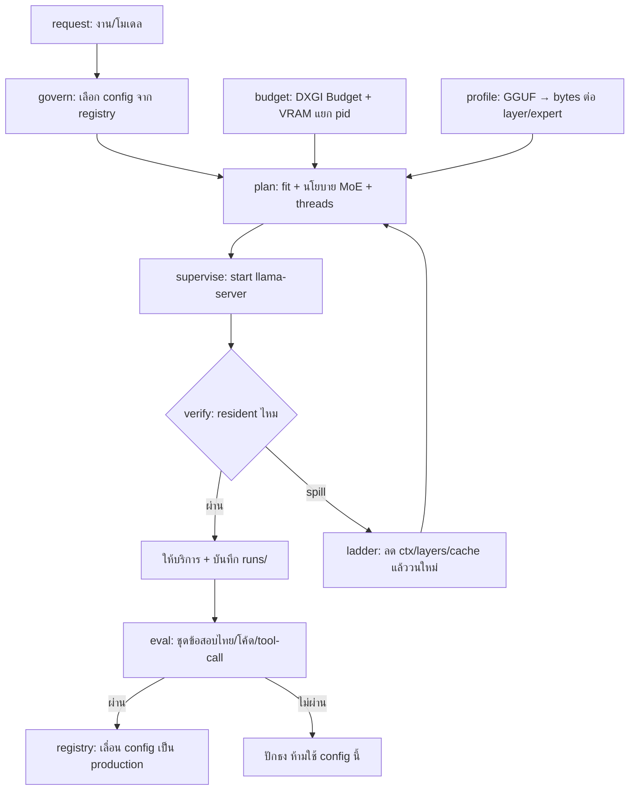

# OverSpec v3 — สถาปัตยกรรม

> 13 พ.ย. 2026 · แทนที่ลำดับงานใน `docs/plan.md` §7 · เหตุผลอ้างอิง `docs/research-prior-art.md`

**หลักเดียว:** เราไม่สร้าง placement/runtime เอง — llama.cpp mainline ทำ placement (`--fit`), MoE offload (`-cmoe`/`-ncmoe`), expert cache (`--moe-cache-mib`), KV cache และ prompt cache ไปแล้ว สิ่งที่ OverSpec ทำคือ **ให้ input ที่ถูกต้อง (งบ VRAM จริง) → ตรวจผลลัพธ์ → ผูกคุณภาพ**

---

## 1. สิ่งที่ตัดออกจากแผน v2

| ของเดิม | คำตัดสิน | เหตุผล |
|---|---|---|
| เขียน kernel / quant เอง | ตัดถาวร | CPU เป็น AVX2 ไม่มี AVX-512/AMX (`docs/plan.md:31`) |
| MTP / speculative | ตัด | วัฒน์แล้วช้ากว่า (8.25 → 4.70 tok/s, `docs/plan.md:27`) |
| planner วาง layer เอง | ตัด | `llama_params_fit` + `--fit` มีแล้ว (fit-params README) |
| streaming จาก SSD | ตัด | `--load-mode` ไม่มีค่า streaming; `-lzm` มีไว้สำหรับ tensor ใหญ่พิเศษเท่านั้น |
| ระยะ 0 (สร้าง runtime) | ปิด | เสร็จแล้ว: llama.cpp + CUDA เห็นการ์ด (`README.md:20`) |
| "OverSpec ต่างจากคนอื่นเพราะรายงาน VRAM จริง" | **คงไว้ แต่แคบลง** | ต่างจริงเฉพาะ G1–G4 ไม่ใช่เพราะ placement |

---

## 2. ภาพรวม



---

## 3. องค์ประกอบ (5 โมดูล + 1 registry)

### M1 `overspec/profile.py` — ต่อยอดจาก `gguf_probe.py`

อ่าน GGUF แล้วคาย **แผนที่หน่วยความจำ** ที่ planner ต้องใช้ ไม่ใช่แค่ metadata

```python
profile(model) -> {
  "arch": "qwen35", "layers": 34, "ctx_train": 262144,
  "dense_bytes_per_layer": [...],      # attention + dense ffn
  "expert_bytes_per_layer": [...],     # ffn_*_exps (0 ถ้าไม่ใช่ MoE)
  "kv_bytes_per_token": 8192,          # จาก head_count_kv × head_dim × layers × dtype
  "quant_bpw": 5.46,
}
```
ของเดิม `gguf_probe.py` นับ tensor ตามชนิดอยู่แล้ว — เพิ่มการแยก dense/expert ต่อ layer (regex `ffn_*_exps` แบบเดียวกับที่ `-ot` ใช้) และคำนวณ KV ต่อ token

### M2 `overspec/budget.py` — งบ VRAM จริง (ช่อง G1+G3)

อินเทอร์เฟซเดียว คืนค่าหนึ่งชุด ไม่ว่าเก็บจากทางไหน:

```python
snapshot() -> {
  "dxgi_budget_mib": 6443,        # IDXGIAdapter3::QueryVideoMemoryInfo → Budget
  "proc_dedicated": {"2332": 790, "15864": 239},   # GPU Process Memory
  "smi": {"total": 8151, "used": 644, "reserved": 241, "free": 7267},
  "fallback_policy": "default|prefer_no_sysmem",
}
```
- **ทำแล้ว:** `overspec/budget.py` — DXGI ผ่าน ctypes (EnumAdapters1 → เลือกการ์ด dedicated มากสุด → QueryVideoMemoryInfo) + per-pid จาก `probe_budget.ps1` + nvidia-smi + policy
- **วัฒน์แล้ว 13 พ.ย. 2026:** DXGI `Budget` คืน **0** แม้สร้าง D3D12/D3D11 device บน adapter แล้ว ⇒ ใช้ `nvidia-smi free − reserved` เป็นเพดานแทน (7090 MiB) และบันทึกเหตุผลใน `errors` ของ snapshot
- **ต้องแก้ก่อนใช้ตัดสินใจ:** ผลรวมต่อ pid (1068 MB) ≠ `used` ของ nvidia-smi (644 MiB) ⇒ ต้องเลือกค่าอ้างอิงเดียวและบันทึกไว้ว่าเลือกอะไร

### M3 `overspec/plan.py` — ห่อ `llama-fit-params` ไม่ใช่เขียน planner ใหม่ (ช่อง G5)

```python
plan(profile, budget, workload) -> {"argv": ["-c","4096","-ngl","32", ...], "why": {...}}
```
ขั้นตอน:
1. `budget_for_fit = dxgi_budget_mib − safety_mib(768) − other_apps_mib`
2. เรียก `llama-fit-params.exe --model X -fitt <budget_for_fit>` → parse argv ที่มันพิมพ์ (`-c`, `-ngl`, `-ot`)
3. ถ้าเป็น MoE (จาก M1): เลือกนโยบายจากตาราง
   - `expert_bytes > budget` → `-cmoe` + `--moe-cache-mib ≈ 10% ของ expert bytes` (ต้องมี mainline — ดู §5)
   - `expert_bytes ≤ budget` แต่ dense ไม่พอ → `-ncmoe N` โดย N = จำนวน layer ที่ต้องผลักลง CPU
4. `-t` จากตารางที่วัฒน์แล้ว (งานค้างเดิม `docs/plan.md:103`) ไม่เดา
5. คาย `argv` + `why` (ทุกตัวเลขที่ใช้ตัดสิน) เพื่อให้ตรวจย้อนได้

### M4 `overspec/supervise.py` — ตรวจว่า resident จริง (ช่อง G2)

```python
supervise(argv) -> {"spill_ratio": 0.02, "verdict": "ok"}
```
1. เก็บ `budget.snapshot()` ก่อนสตาร์ท
2. สตาร์ท `llama-server` ด้วย argv จาก M3, อ่าน log
3. parse `load_tensors: CUDA0 model buffer size = X MiB` (บรรทัดนี้มีจริง: `runtime/diag.log:195`)
4. เก็บ snapshot หลังโหลด → `Δresident = proc_dedicated_after − before`
5. `spill_ratio = 1 − Δresident / X` — **ถ้า > 0.10 ถือว่า spill** (เกณฑ์ตั้งต้น ไม่ใช่ความจริงจากตำรา)
6. spill → ladder: `ctx ÷ 2` → `-ngl −4` → `--moe-cache-mib ×0.5` → ยอมแพ้ + รายงาน
7. บันทึก `runs/<timestamp>.json`: argv, snapshot ก่อน/หลัง, spill_ratio, tok/s ที่วัฒน์

### M5 `overspec/eval.py` — ประตูคุณภาพ (ช่อง G4)

- 20–30 ข้อจากงานจริง: ไทย (ThaiExam subset) + โค้ด + tool-call (BFCL-style) — ใช้ของที่มี (`docs/research-prior-art.md` §5)
- เก็บ `config_hash → {score, tok/s, spill_ratio}`
- กติกา: config ที่คะแนนตก > 2 ข้อจาก baseline **ห้ามเลื่อนเป็น production** แม้จะเร็วขึ้น

### M6 `govern` — registry + routing (ช้า ๆ ก่อน)

- `configs/<model>/<hash>.json` = ผลจาก M3+M4+M5
- request class (`chat|code|agent`) → config ที่ผ่าน gate แล้ว
- ยังไม่ทำ multi-model swap ในเฟสแรก — llama-swap ทำได้อยู่แล้วถ้าต้องใช้

---

## 4. เกณฑ์ผ่าน

| ข้อ | ตัวชี้วัด | เกณฑ์ |
|---|---|---|
| P1 truth | probe คืน DXGI Budget + per-pid ได้ในคำสั่งเดียว | ค่าเสถียร 10/10 รอบ ห่างกัน < 5% |
| P2 plan | plan ของ 9B บนเครื่องนี้ | ไม่ต้องแก้มือ, reproduce argv ได้ |
| P3 spill | เคสที่วัฒน์ไว้ (`README.md:36-38`) | ตรวจเจอ spill และรายงานเหตุผลถูก |
| P4 quality | eval 25 ข้อ | config ใหม่ตกไม่เกิน 2 ข้อ |
| P5 prefill | prefill 9B | ≥ 20 tok/s (เป้าเดิม `docs/plan.md:92`) |
| P6 RAM | หลังโหลด | เหลือ ≥ 6 GB |

---

## 5. ความเสี่ยงที่ต้องพิสูจน์ก่อนลงทุน

| # | ความเสี่ยง | วิธีพิสูจน์ | ถ้าผิด |
|---|---|---|---|
| R1 | mainline อ่าน GGUF ของ ollama ไม่ได้ (`qwen35.rope.dimension_sections`, `docs/plan.md:29`) | โหลดไฟล์เดิมด้วย `llama-fit-params` mainline build ใหม่ | ต้องแปลง/เรนควอนต์ก่อน — งานเพิ่ม |
| R2 | `--moe-cache-mib` จำกัด batch ≤ 32 tokens และ single device | อ่านโค้ด PR + ลองกับ GLM บนการ์ดเดียว | agent ที่ prefill ยาวจะไม่ได้กำไร |
| R3 | DXGI Budget ผ่าน COM จาก Python/PS ไม่เสถียร | เขียน `Add-Type` แล้ววัด 10 รอบ | ใช้ `nvidia-smi reserved` เป็นเพดานแทน (หยาบกว่า) |
| R4 | ผลรวม counter ≠ nvidia-smi used (§3 M2) | เทียบ 3 สถานะ: ว่าง / มี Chrome / กำลังโหลดโมเดล | ต้องนิยาม metric ใหม่ |
| R5 | 8 GB อาจเล็กเกินกว่าจะเห็นกำไรจาก expert cache | วัฒน์ GLM-4.7-Flash (19 GB) ตอน RAM ว่าง | ถ้าไม่กำไร → ตัดระยะ MoE ออก และโฟกัส 9B |

**R5 คือเดิมพันใหญ่:** ตัวเลข 1.57×–2.20× ใน PR มาจากการ์ด 24–32 GB ถ้า 8 GB ให้ผลไม่ถึง 1.2× สถาปัตยกรรมนี้ควรหยุดที่ P1–P3 (แก้ paging + spill) แล้วเลื่อน MoE ไปทีหลัง

---

## 6. ลำดับงานใหม่ (แทน `docs/plan.md` §7)

| เฟส | งาน | สถานะ |
|---|---|---|
| **P1** | `budget.py` (DXGI + per-pid + policy) | ✅ DXGI ทำงานได้แต่คืน 0 — ถอยไป smi; per-pid วัฒน์จริง |
| **P2** | `profile.py` ต่อจาก `gguf_probe.py` | ✅ แยก dense/expert + KV ต่อ token; เทสต์ด้วย GGUF สังเคราะห์ |
| **P3** | `plan.py` ห่อ `llama-fit-params` + นโยบาย MoE | ✅ วัฒน์กับ build จริง: ตรวจเองว่า build ไม่มี `--moe-cache-mib` → ออก `-ncmoe` |
| **P4** | `supervise.py` + spill ladder | ✅ วัฒน์กับ server ปลอม: จับ spill (จอง 4458 / resident 1000) และไล่ ladder |
| **P5** | `eval.py` 25 ข้อ + gate | ⚠️ ชุดข้อสอบ 25 ข้อ (ไทย/โค้ด/tool) + gate พร้อม; ยังไม่รันกับโมเดลจริง |
| **P6** | อัป mainline (moe-cache) + R1/R2 | ❌ ยังไม่เริ่ม — ต้องดาวน์โหลด build mainline และทดสอบ GGUF ของ ollama |
| **P7** | `govern` + routing | ⚠️ registry มีแล้ว (promote/reject); routing ตาม request class ยังไม่ทำ |

**หลักฐานการวัฒน์ P1–P5:** `python -m pytest -q` → 41 passed · `python -m overspec.cli budget --human` → เพดาน 7090 MiB · `python -m overspec.cli plan runs/_probe.gguf --budget-mib 1200` → `-ngl 8 -ncmoe 1` พร้อมเตือนว่า build ไม่มี `--moe-cache-mib`

**ที่ยังไม่วัฒน์กับของจริง:** ยังไม่ได้รัน 9B/GLM ผ่าน `supervise` เพราะไฟล์โมเดลอยู่นอกโปรเจกต์ (`D:\Models\ollama\blobs`) — ต้องเปิดโฟลเดอร์นั้นให้เซสชันก่อน

---

## 7. โครงไฟล์เป้าหมาย

```
overspec/
  gguf_probe.py       # ของเดิม (M1 ต่อยอด)
  profile.py          # M1
  budget.py           # M2 (เรียก probe_budget.ps1 + DXGI)
  probe_budget.ps1    # ต้นแบบที่วัฒน์แล้ววันนี้
  plan.py             # M3
  supervise.py        # M4
  eval.py             # M5
  registry.py         # M6
configs/<model>/<hash>.json
runs/<timestamp>.json
```
